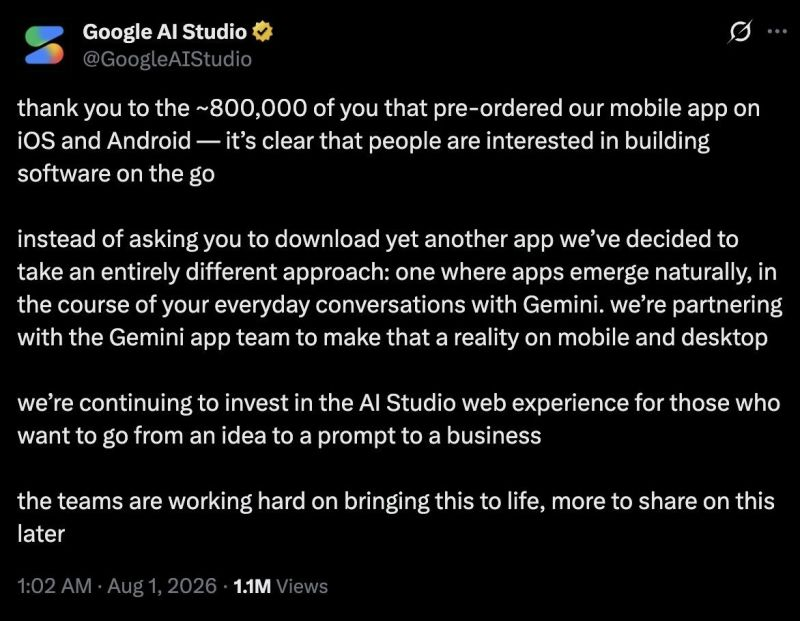

# Not Every AI Investment Needs Another Product
Subtitle: Sometimes the better strategy is to bring the capability to where the user already is.
Tags: AI
Series: Surabhi's Slate
Date: 2026-08-14
Summary: A decision from Google AI Studio caught my attention recently. The team had around 800k people pre-order its mobile app.

*Originally posted on [LinkedIn](https://www.linkedin.com/feed/update/urn:li:activity:7493882850060943360/) on August 14, 2026.*

A decision from Google AI Studio caught my attention recently. The team had around **800k people pre-order its mobile app**. And yet, the standalone app was not launched. Instead, Google chose a different direction.

Rather than asking users to download another app, AI Studio is bringing its app-building capabilities into Gemini, allowing apps to emerge naturally through everyday conversations. The web experience will continue to support users who prefer a dedicated building environment.

That is an interesting product decision. Because the obvious reaction to strong demand is: **Build the product. Scale it. Invest more**.

The more strategic question is:  
**Where should that investment create the most value**?

A standalone application creates another destination. Integrating the capability into an existing platform can eliminate that destination altogether. AI investment is growing rapidly, but investment alone doesn't create product value.

**Where the capability lives can be just as important as what the capability can do**.

A useful product strategy is therefore not simply: *What should we build next*?  
It is also: *What should become part of something that already works*?

This is where platform strategy becomes important. A capability may deserve investment without deserving another product, login, interface, or destination.

Google's decision is a good reminder that **product expansion and product consolidation are not opposites**.

Sometimes the next stage of growth comes from adding something new.

Sometimes it comes from making something valuable disappear into the experience users already have.  
And there is a broader lesson for AI strategy.  
**AI investment should follow user behaviour, not simply product boundaries**.

The technology may be new. The user's expectations are not. They still want less friction, fewer steps and a clearer path from intent to outcome.

That is why some of the most important AI decisions being made today may not be about launching another AI product.

They may be about deciding **where AI should become invisible**.

💬 **Question to Ponder**:  
When a new AI capability proves valuable, would you build it as a separate productor make it part of a platform your users already depend on?

#TechnologyLeadership #AIStrategy #ProductStrategy #DigitalTransformation #PlatformStrategy #ArtificialIntelligence

---

*Join the conversation [on LinkedIn](https://www.linkedin.com/feed/update/urn:li:activity:7493882850060943360/).*
