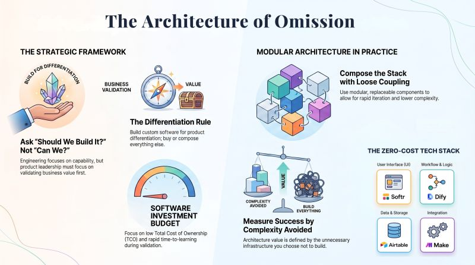

# Why I Deliberately Didn't Build Half the System
Subtitle: Behind Every Technology Leadership Decision – Part 3
Tags: AI, Technical, Krishna Uvaca
Series: Surabhi's Slate
Date: 2026-07-25
Summary: One question kept coming up after I shared Krishna Uvacha. "How much did this MVP cost to build?" The answer surprised most people. ₹0 in software investment.

*Originally posted on [LinkedIn](https://www.linkedin.com/feed/update/urn:li:activity:7486695503058055168/) on July 25, 2026.*

One question kept coming up after I shared Krishna Uvacha.  
"How much did this MVP cost to build?"  
The answer surprised most people. ₹0 in software investment.

Not because I avoided engineering.  
Because I treated engineering as an investment, not just an activity. Every hour of engineering needed to create business differentiation.  
━━━━━━━━━━━━━━  
**The Leadership Decision**  
Four days into the build, I reached a familiar crossroads.  
Should I invest weeks building a custom backend or first validate whether the product actually deserved that investment?

This one decision shaped the entire architecture.

Instead of custom-building every capability, I identified the few capabilities that truly differentiated the product. Everything else became a composable architecture.

UI → Softr  
Workflow → Dify  
Data → Airtable  
Integration → Make  
AI → LLM + Bhagavad Gita Knowledge Base  
━━━━━━━━━━━━━━  
What This Taught Me  
Technology decisions are investment decisions.  
Most engineers ask, "Can we build it?"  
Technology leaders ask, "Should we build it?"

Differentiate where it matters. Compose everything else. The goal wasn't "no-code." The goal was investing custom engineering only where it created competitive advantage.

Architecture influences business outcomes. This one decision optimized for:  
→ Reduced Time-to-Value  
→ Faster Product Validation  
→ Lower Total Cost of Ownership (TCO)  
→ Loose Coupling  
→ Rapid Iteration  
→ Component Replaceability

Engineering should maximise learning before scaling investment.  
Looking back, I wasn't simplifying the architecture. I was practising what I now think of as an Architecture of Omission. Every component I deliberately didn't build helped to validate the product sooner.  
━━━━━━━━━━━━━━  
**One Leadership Principle**  
Over nearly two decades of building enterprise platforms, one principle has remained remarkably consistent. Don't build infrastructure until the product proves it deserves infrastructure. That's not an MVP principle. That's an Enterprise Technology Strategy.

Architecture isn't measured by how much you build. It's measured by how much unnecessary complexity you successfully avoid.

Technology evolves. Leadership adapts.  
━━━━━━━━━━━━━━  
🌿 Try Krishna Uvaca: https://krsna.softr.app

As you explore it, don't evaluate the tech stack. Ask yourself one question. Did the experience create value without making you think about the technology behind it?  
━━━━━━━━━━━━━━  
If you had to remove half your product today, what would you keep, and why?

#TechnologyLeadership #ProductStrategy #BuildVsBuy #EnterpriseArchitecture #SoftwareArchitecture #TechnologyStrategy #GenAI #ArtificialIntelligence #BuildInPublic

---

*Join the conversation [on LinkedIn](https://www.linkedin.com/feed/update/urn:li:activity:7486695503058055168/).*
