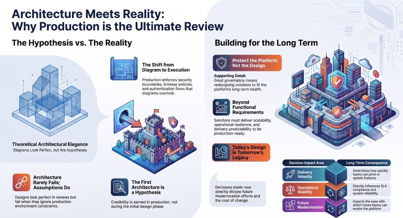

# Architecture Rarely Fails. Assumptions Do
Subtitle: Behind Every Technology Leadership Decision – Part 4
Tags: Technical, Krishna Uvaca
Series: Surabhi's Slate
Date: 2026-07-27
Summary: When I started building Krishna Uvacha, the architecture looked beautifully simple. Browser → Workflow → AI → Response Minimal. Composable. Easy to explain.

*Originally posted on [LinkedIn](https://www.linkedin.com/feed/update/urn:li:activity:7487405167001223168/) on July 27, 2026.*

When I started building Krishna Uvacha, the architecture looked beautifully simple.  
**Browser** → **Workflow** → **AI** → **Response**  
Minimal. Composable. Easy to explain.

Then I opened it in a browser. Suddenly, everything behaved differently. Not because the AI failed. Not because the workflow was wrong. Because software never runs inside architecture diagrams.

It runs inside an operating environment - browsers, networks, identity providers and security policies. That's where architectural assumptions quietly become operational constraints.  
━━━━━━━━━━━━  
**The Leadership Decision**  
The technical fix wasn't the interesting part. The **architectural trade-off** was. I could optimise for design purity or optimise for operational reality.  
I chose the second.

The redesign wasn't about making the application work. It was about making the platform more resilient.  
━━━━━━━━━━━━  
**What This Means**

Every architecture is an investment in future delivery. Every decision either reduces or compounds the future Cost of Change.

A shortcut today rarely slows down the person writing it. It slows down the next team maintaining it. That's how **technical debt** quietly accumulates.

And when something works perfectly for one user, the next question isn't, "*Does it work*?"  
It's, "*Will it behave the same for one thousand*?"

That's when architecture stops being about functionality and starts becoming about scalability.  
━━━━━━━━━━━━  
One lesson has stayed with me throughout my career.  
**Design reviews validate ideas**.  
**Production validates architecture**.  
Everything before production is an assumption. Everything after production is evidence.  
━━━━━━━━━━━━  
🌿 Try Krishna Uvacha: https://krsna.softr.app

If you use it today, you probably won't notice these decisions.  
That's the point. The best architecture is invisible. The experience isn't.  
━━━━━━━━━━━━  
💬 **I'd love to hear your perspective**.  
What's one assumption that completely changed once your solution met production?

#TechnologyLeadership #EnterpriseArchitecture #SoftwareArchitecture #SystemDesign #TechnologyStrategy #PlatformEngineering #DigitalTransformation #BuildInPublic

---

*Join the conversation [on LinkedIn](https://www.linkedin.com/feed/update/urn:li:activity:7487405167001223168/).*
