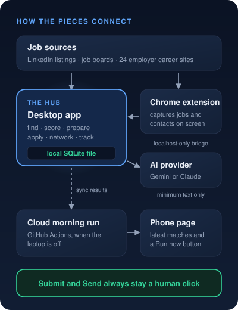
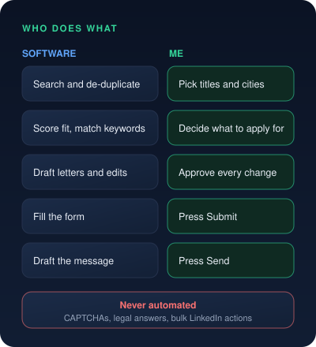
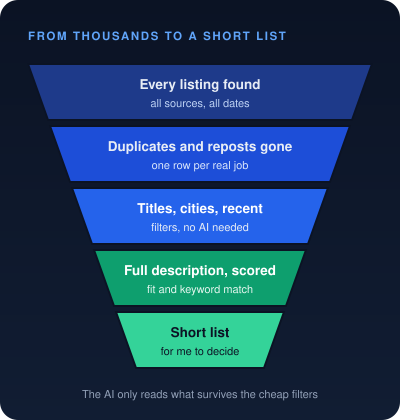

# AutoPilot: An AI Assistant for the Job Hunt
Subtitle: A local-first job-search assistant that finds, scores and prepares, while every application and message still goes out by a human click.
Tags: AI, Technical, Governance
Series: Build Logs
Date: 2026-10-28
Summary: A local-first job-search assistant that finds, scores and prepares, while every application and message still goes out by a human click.

A serious job search is a second job. Roles are scattered across a dozen sites. The same posting shows up three times under different names. Every application wants a tailored resume and a cover letter, and every conversation needs a follow-up that is easy to forget.

Most automation tools answer this by applying to hundreds of jobs on your behalf. That gets accounts restricted, and it throws away the one thing that matters most in a job search, judgment.

So I built **AutoPilot** around a different split. The software does the searching, sorting and drafting. I make every decision that leaves my hands.

You can see the online page at [autopilot.sandeepmidde.com](https://autopilot.sandeepmidde.com).

## What It Does

| Stage | What AutoPilot handles | What stays with me |
|---|---|---|
| Find | Searches job boards, LinkedIn's public listings and 24 employer career sites, removes duplicates and reposts | Choosing titles, cities and companies to skip |
| Fit | Scores each role against my profile, with strengths, concerns and an ATS keyword match | Deciding what is worth applying for |
| Prepare | Drafts cover letters, truthful resume keyword changes and interview prep packs | Approving every change |
| Apply | Opens the real form and fills the confident fields | Pressing Submit |
| Network | Drafts LinkedIn notes and follow-up emails by persona | Pressing Send |
| Track | Pipeline, outcomes, response rates and a daily dashboard | Interviews and negotiation |

## Architecture

The desktop app is the hub. Everything lives in one local SQLite file on my laptop. A Chrome extension acts as its eyes inside the browser and passes what it captures over a localhost-only bridge. When the laptop is off, a scheduled GitHub Actions run does the morning search and scoring in the cloud, and the phone page shows the results.

- **Local first.** Jobs, scores, contacts and notes stay on my machine. Only the minimum text needed is sent to the AI provider.
- **Provider choice.** Gemini runs by default. On my laptop, Claude re-scores the cloud's results, and its score is never overwritten by Gemini's.
- **One row per job.** The same role listed on three sites is matched by company, title and city, scored once, and its history kept for good.

## Designing for Honest Scores

Early versions scored jobs from 500-character snippets, and the numbers looked precise but meant little. So the rule became simple. **No full description, no score.** AutoPilot now looks up the whole posting first, from LinkedIn or the employer's own page, and hides snippet-only jobs by default.

The fit score itself runs in two passes. Hard checks come first, such as work authorization, language and location. Then four weighted parts, Technical, Experience, Culture and Career, add up to a verdict from Strong to Poor, with the posting's own words quoted when it says Skip.

Two quieter checks protect the score.

- **Posting integrity.** Hidden text, invisible characters and lines written to manipulate an AI reader are removed or flagged before the AI reads a posting.
- **Repost detection.** LinkedIn hides its "Reposted" label from logged-out visitors, but a repost keeps its original job id. Comparing ids revealed that 43 of 86 recent listings were reposts.

## Human in the Loop

The line between automation and judgment is drawn on purpose.

- **Never submits.** Assisted apply fills fields it is sure of and stops. It never ticks a legal or work-authorization answer, and it stops at any CAPTCHA.
- **Never sends on LinkedIn.** The extension drafts the message. I press Send.
- **Reads, never clicks.** The extension's "Send all" captures the job cards already on screen. It never opens, scrolls or clicks on a job site.
- **Approve every change.** Resume edits go into a copy of my file, and only the ticks I approve.

## Results

The first build day fixed a search that looked frozen.

| Check | Before | After |
|---|---|---|
| Fetch, 12 titles in one city | 30+ minutes, never finished | 58 seconds, 75 relevant jobs kept |
| AI scoring of 8 jobs | About 2.5 minutes, 8 calls | 23 seconds, 1 call |
| Daily AI quota used up | Slept 8.7 hours, looked frozen | Stops at once and says when it resets |
| Job list refresh | One database query per row | One query, 0.3 seconds for 5,000 jobs |

## What's Next

- Read job alert emails from sites that block direct search.
- Confirm "Send all" on every supported job site.
- A drag-and-drop pipeline board and a Windows installer.

## Takeaway

- **The software** does the tireless work. Searching, de-duplicating, scoring and drafting.
- **The design** keeps the scores honest and the data on my machine.
- **The human** makes every call that carries my name.

A job search is personal. The best automation gives back hours, and never takes away the decision.
