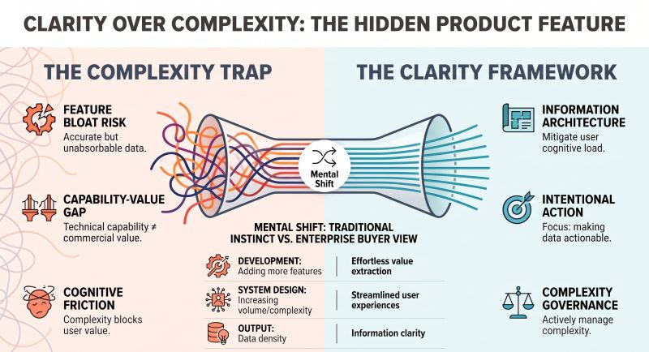

# Clarity Is a Product Feature
Tags: AI, Krishna Uvaca
Series: Surabhi's Slate
Card: linkedin.jpg
Date: 2026-08-01
Summary: The first version of a product often focuses on one question: Does it work? Once that answer becomes "yes," a better question emerges. Does it feel effortless?

*Originally posted on [LinkedIn](https://www.linkedin.com/feed/update/urn:li:activity:7489383211035369472/) on August 1, 2026.*

The first version of a product often focuses on one question:  
**Does it work**?  
Once that answer becomes "yes," a better question emerges.  
**Does it feel effortless**?

That was the next stage in the evolution of Krishna Uvacha. The wisdom didn't change. The conversation did.

Instead of presenting everything together, each response was carefully structured. One section created context. Another offered perspective. Another encouraged reflection. The destination stayed the same. **The journey became easier to follow**.

That's when an important lesson became clear. People rarely remember how much information a product provides. They remember how easily they understood it. This is where **Information Architecture quietly becomes a product feature**.

Good products don't ask users to work harder. They reduce the effort required to think.

This principle extends far beyond the product. The same applies to dashboards. Executive presentations. Customer journeys. Even strategy documents. More information doesn't always create more value. Better organization often does.

Three ideas have stayed with me:  
• Products don't communicate information. They shape understanding.  
• Clarity isn't about saying less. It's about organizing better.  
• The best experiences make complexity feel simple.

Every update to Krishna Uvacha reinforced the same principle. The goal wasn't to make the product say more. It was to help people absorb more from what was already there. Sometimes the biggest product improvement isn't another feature.  
**It's a clearer experience**.

🌿 Explore Krishna Uvacha : https://krsna.sandeepmidde.com  
As you explore it, notice not only the wisdom being shared but how naturally the conversation unfolds.

💬 **Question to Ponder**  
What's one product improvement you've made that didn't add a single feature but made the experience significantly better?

#TechnologyLeadership #ProductStrategy #CustomerExperience #InformationArchitecture #ProductDesign #Leadership #BuildInPublic

---

*Join the conversation [on LinkedIn](https://www.linkedin.com/feed/update/urn:li:activity:7489383211035369472/).*
