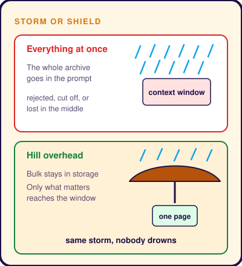
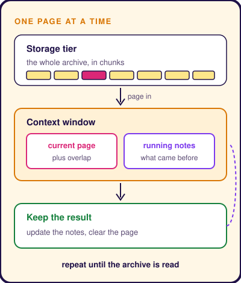

# Optimizing Context Windows
Subtitle: A storm too big for any village, and a hill lifted overhead so everyone gets a dry place to stand.
Story: ⛰️ Lifting Govardhan · Krishna
Tags: AI, Technical
Series: Tarang Tales
Date: 2026-10-28
Summary: Why an AI cannot read everything at once, and how it is handed just the right part, told through Krishna and the great storm.

## One Small Question

Someone asks you, *"Who built the bridge to Lanka?"*

The whole **Ramayana** lies open in front of you. Would you read it aloud from page one until you reach the bridge?

Of course not. You would turn to the right chapter, read a few lines and answer.

An AI has the same problem. It can only keep a little text in mind at a time. Pour a whole library over it, and it gets lost.

So how do engineers keep an AI from drowning in words? The answer is in a story about a storm.

## Boy Who Questioned the Sky

Long ago, in the green village of **Vrindavan**, the cowherds prepared a grand feast every year for **Indra**, king of the gods and lord of thunder and rain.

That year, a young boy watched the preparations and frowned. His name was **Krishna**.

"Father," he asked, "why do we feast for a god far away in the clouds? Look at **Govardhan**. That hill feeds our cows. Its streams fill our pots. Let us honour the hill that cares for us."

The elders looked at one another. The boy made sense.

So the feast went to Govardhan.

## Indra's Rage

Far above, on his throne in the sky, Indra saw the empty altar.

His face darkened.

"A cowherd boy tells them to forget me? Then let them remember me. Send the clouds. All of them."

The sky over Vrindavan turned black at noon.

Thunder split the air. Lightning cracked the trees. And then the rain came. Not a shower. A wall of water, falling without end.

Huts collapsed. Lanes became rivers. Calves bawled in the rising flood. Mothers held their children above the water.

"Krishna!" the villagers cried. "Save us!"

## Krishna Lifts Govardhan

Krishna walked calmly through the storm to the foot of Govardhan.

He bent down. He slid one small hand under the hill.

And he lifted.

The earth groaned. Rocks tumbled. The whole hill rose off the ground, higher and higher, until it rested on the tip of his little finger, like a giant umbrella.

"Come!" he called. "Everyone! Bring the children. Bring the cows. There is room for all of you."

The villagers ran beneath it. The rain hammered on the hill above them. Water poured off its slopes in streams around the edges.

But underneath, the ground was dry.

For seven days and seven nights, they lived under the hill. No one fought the storm. Each family simply looked after the small, dry space around them, one day at a time.

On the eighth morning, Indra gave up. The clouds parted. The sun came out.

## What Krishna Really Did

Krishna did not stop the rain. He put the hill **between the rain and the people**.

Now think of the AI.

**The rain** is all the information there is. Every report, every email, every page. Far too much to take in at once.

**The dry space under the hill** is how much the AI can hold at one time. Engineers call this its **context window**. Like the space under the hill, it has edges.

**The hill** is a search step that stands between all that information and the AI. Everything lands on it first. It lets through only the few pieces the question needs.

Just as you turned to the one chapter about the bridge, and left the rest of the Ramayana closed.

## Living Under the Hill

So engineers build AI systems the way Krishna sheltered Vrindavan.

Everything is kept in a store, cut into small pieces, like pages of a book.

When a question comes in, the system fetches only the few pieces that matter. This step is the heart of [RAG](posts/mountain-quest/).

For a really big job, the AI works one piece at a time, like the villagers living one day at a time. It reads a piece, writes a short note about it, then moves to the next. The notes travel forward, so it never loses the thread.

## Story to System

| In the story | In an AI system |
|---|---|
| Seven days of endless rain | More information than the AI can take in |
| Dry space under the hill | What the AI can hold at once, its context window |
| The hill between rain and people | A search step that lets only the needed pieces through |
| Streams running off the slopes | The few pieces that reach the AI |
| One day at a time | Working piece by piece, with notes carried forward |

## See It Work

A bank wants to know what its customers complained about most in the last ten years.

There are thousands of complaint letters. Far too many for the AI to read in one go.

1. **Split.** The letters are grouped by month. Ten years makes 120 small bundles.
2. **Read one bundle at a time.** For each month, the AI writes a short note. *"Most complaints this month were about card fees."*
3. **Gather the notes.** The 120 short notes are small enough to read together.
4. **Answer.** The AI reads all the notes and writes the ten-year picture.

The AI never had to swallow the flood. It drank one cup at a time.

## Where the Story Stops

Krishna's hill kept out every drop. Reading one piece at a time has a small gap.

The AI sees only one month at a time. So it may not notice that a problem from January came back in December.

Good notes help it remember. Smart searching helps it find the link.

## Takeaway

You did not need the whole Ramayana to answer one question. You needed the right page.

Give the AI the right page, not the whole book.

> The window is small. Fill it with what matters.
