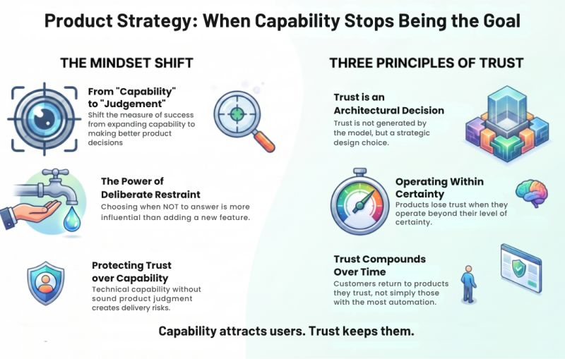

# Every Product Chooses Its Definition of Success
Tags: AI, Governance, Krishna Uvaca
Series: Surabhi's Slate
Card: linkedin.jpg
Date: 2026-07-29
Summary: The most dangerous mistake a technology leader can make is confusing a strategic risk with a simple design choice.

*Originally posted on [LinkedIn](https://www.linkedin.com/feed/update/urn:li:activity:7488303596254425090/) on July 29, 2026.*

The most dangerous mistake a technology leader can make is confusing a strategic risk with a simple design choice. Early on, operational metrics look deceptively simple:  
↳ Expand functional features.  
↳ Answer more customer inquiries.  
↳ Scale market capabilities.

But true governance means looking past that noise. The focus must shift from volume to the precise business value guaranteed. The defining leadership question quietly becomes:  
👉 **When must management deliberately choose to exercise restraint**?

That single decision impacts market positioning far more than any feature deployment.  
━━━━━━━  
The challenge isn't expanding technical capacity. It is protecting brand authority and deciding when a product has earned the right to speak for the enterprise. **This isn't an engineering problem, it's a strategy decision**.

Aggressive deployment without sound executive judgment creates severe reputation risk. Protecting customer trust matters far more than demonstrating technical dominance.  
━━━━━  
Shifting this mindset redefines the strategic framework:  
• Instead of demanding: "*How can we deliver more output*?"  
• Executive leadership asks: "*How can we secure deeper organizational trust*?"

Three core governance principles emerge:  
1\. **Products rarely lose market share from a lack of capability**. They lose it when operating beyond their certainty.  
2\. **Technology generates capabilities**. Strategy decides if they align with the company's risk profile.  
3\. **Trust is not an engineering variable**. It is a foundational business model asset.  
━━━━━━━━  
This philosophy guided how Krishna Uvacha was built, but the mandate extends across every industry.

**Market leadership isn't won by shipping features faster. It is won by ensuring your customers can rely on your judgment**.  
━━━━━━━━━  
🌿 **Explore Krishna Uvacha: https://krsna.sandeepmidde.com**

Don't judge it by the volume of answers. Judge it by whether its judgment aligns with the standards you require to make your next strategic move.  
━━━━━━━━  
💬 **Question to Ponder**:  
Have you ever intentionally scaled back a product's capabilities to protect your organization's long-term customer trust?

#TechnologyLeadership #ProductStrategy #ResponsibleAI #ArtificialIntelligence #Leadership #BuildInPublic

---

*Join the conversation [on LinkedIn](https://www.linkedin.com/feed/update/urn:li:activity:7488303596254425090/).*
