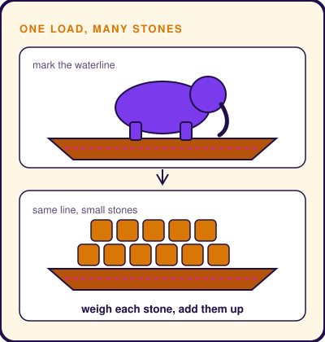
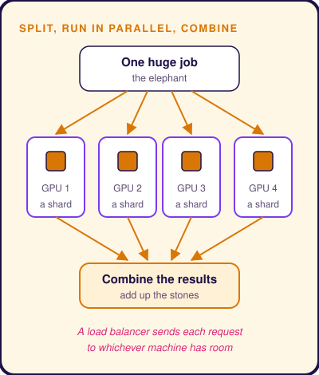

# Distributed Computing for AI
Subtitle: Asked to weigh an elephant with a small scale, a clever courtier weighs a boatload of stones instead.
Story: 🐘 Weighing the Elephant · Tenali Raman
Tags: AI, Technical
Series: Tarang Tales
Date: 2026-10-28
Summary: How AI systems split work too heavy for one machine across many, and add the pieces back together.

## Pile of Answer Sheets

It is exam season. A teacher has a mountain of answer sheets to mark by morning.

Alone, she would need a week.

So she calls nine colleagues. She splits the pile into ten stacks. Everyone marks at the same time. At midnight, they add up the marks together.

Done in one evening.

Big AI systems face piles like this all the time. Work so heavy that no single computer can carry it.

The trick to handling it comes from an old folk tale. It is told in India of the witty courtier **Tenali Raman**, and in China of the boy **Cao Chong**.

## King's Challenge

The royal court is buzzing. A foreign envoy has brought the king a gift. A giant war elephant.

"Magnificent," says the king. "But how much does it weigh?"

Silence.

The royal scale is brought out. It is small enough to carry in two hands.

"Weigh the elephant on this," says the king, "by sunset."

The ministers look at each other. One whispers, "We would need a scale the size of a palace."

Tenali Raman smiles. "Give me a boat, Your Majesty. And a lot of stones."

## Down by the River

At the river, Tenali leads the elephant onto a large boat. The boat sinks low in the water.

He takes a piece of chalk and draws a line on the hull, exactly where the water touches it.

Then he leads the elephant off. The boat rises.

"Now," he tells the servants. "Load stones. Stop when the water reaches my mark."

Basket after basket, they fill the boat. It sinks lower. Lower. The water touches the line.

"Stop."

Each stone is small enough for the little scale. Ten servants weigh ten stones at a time, side by side. They add up every number.

Tenali bows. "Your Majesty. Your elephant weighs exactly this much."

The court bursts into applause.

## What Tenali Knew

**The elephant** is a job too big for one computer. Some AI systems are so large that they do not even fit into one machine's memory.

**The small scale** is a single computer. Useful, but limited.

**The stones** are the job, cut into small pieces. Together they equal the whole, just as the stones matched the elephant's waterline. Each piece fits one machine.

**The servants weighing side by side** are many computers working at the same time. Engineers call this **distributed computing**. Because no stone depends on another, nobody has to wait for anyone else.

**Adding up the numbers** is the final step. The small results are combined into one answer.

Just as the teacher split the answer sheets into stacks.

## Building with Stones

So engineers build big AI systems the way Tenali weighed the elephant.

They cut the work into pieces that fit. A model too big for one machine is split into parts, and each part lives on a different machine. A huge pile of training examples is split into stacks.

They hand the pieces to many machines at once. Each one works on its own piece.

They gather the results and combine them into one answer.

And when thousands of people ask questions at the same moment, a traffic controller sends each new question to whichever machine has room. No servant stands idle while another is buried in stones.

## Story to System

| In the story | In distributed computing |
|---|---|
| The elephant | A job too big for one computer |
| The small scale | One computer, with limits |
| Stones that match the waterline | Small pieces that add up to the whole job |
| Servants weighing side by side | Many computers working at once |
| Adding up the weights | Combining the results |

## See It Work

A team is teaching an AI from a huge library of examples.

1. **Split.** They divide the examples into eight equal stacks.
2. **Hand out.** Each stack goes to one of eight machines.
3. **Work together.** All eight learn from their stack at the same time.
4. **Combine.** After each round, the machines share what they learned and agree on one update.

The job finishes in about an eighth of the time.

## Where the Story Stops

Stones add up perfectly. Computer work is messier.

The machines often need to talk to each other while they work, and talking takes time. The less they need to talk, the closer they get to Tenali's perfect sum.

## Takeaway

The teacher did not mark faster. She split the pile.

When a job is too big for one machine, cut it into pieces and share them out.

> When the load is too heavy to lift, split it into stones.
