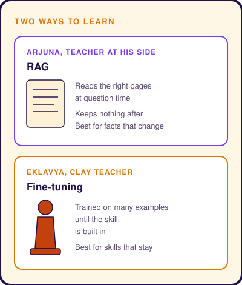

# Fine-Tuning vs RAG
Subtitle: Turned away by Drona, Eklavya shapes a clay teacher and trains until the skill is his own.
Story: 🏹 Eklavya's Clay Teacher · Eklavya
Tags: AI, Technical
Series: Tarang Tales
Date: 2026-10-28
Summary: When to bake knowledge into a model's weights and when to hand it the right pages at the moment it answers.

## Two Students

In the **Mahabharata**, the great teacher **Drona** trains the princes of Hastinapura in archery. His finest student is **Arjuna**, who learns with Drona at his side, asking questions and getting answers in the moment.

A young hunter named **Eklavya** asks Drona to teach him too. Drona turns him away. Eklavya goes back to the forest, shapes a statue of Drona out of clay and practises in front of it every day. With no one to ask, he repeats each shot until it becomes instinct. In time his skill rivals Arjuna's.

## Two Ways to Teach a Model

A language model can learn something new in two very different ways.

- **Retrieval-Augmented Generation (RAG).** At question time, the system finds the relevant pages and places them in front of the model. The model reads them, answers and keeps nothing afterwards. This is Arjuna with Drona beside him. The guidance is fresh each time and can change tomorrow.
- **Fine-tuning.** The model is trained further on many examples, which adjusts its internal **weights**, the numbers that shape how it responds. This is Eklavya at the clay statue. Once trained, the skill is part of the model and needs no reference at answer time.

## Choosing the Right Student

Neither student is better. They suit different jobs.

- **Use RAG for facts that change.** Prices, policies, product catalogues and documents are updated all the time. Retrieval keeps answers current and lets the model show its sources.
- **Use fine-tuning for skills that stay.** A house writing style, a strict output format, a domain's vocabulary or a narrow task done thousands of times a day all benefit from being trained in.
- **Combine them when you need both.** A fine-tuned model that writes in the right shape, fed fresh facts by retrieval, gets the best of each student.

A common mistake is to fine-tune a model on facts. The facts go stale, the model cannot cite where they came from, and updating them means training again.

## Takeaway

Eklavya shows what practice can build into a learner. Arjuna shows what a teacher at your side can add in the moment. Good AI systems decide, skill by skill, which kind of learning each piece of knowledge needs.

> Train the skills that never change. Retrieve the facts that always do.
