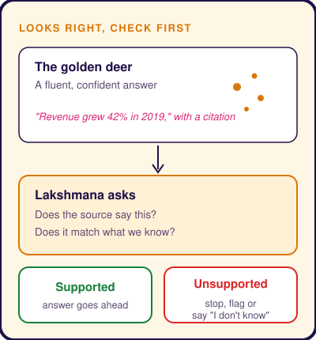
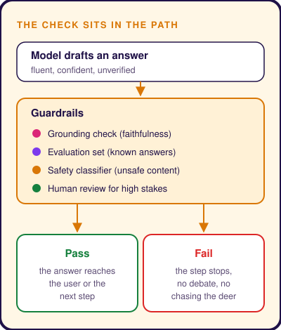

# Mitigating AI Hallucinations
Subtitle: A golden deer too perfect to be real, and the one voice that said check before you chase.
Story: 🦌 The Golden Deer · Lakshmana
Tags: AI, Technical, Governance
Series: Tarang Tales
Date: 2026-10-28
Summary: Why fluent AI answers can still be false, and how guardrails and evaluation catch them before anyone acts on them.

## Too Perfect to Be Real

During the long exile in the **Ramayana**, **Rama**, **Sita** and **Lakshmana** live quietly in the forest. One morning a deer steps out of the trees. Its coat shines like gold and its antlers glitter like jewels. It is the most beautiful creature Sita has ever seen, and she asks Rama to bring it to her.

The deer is not a deer. It is the demon **Maricha**, disguised to lure Rama away so that Sita can be taken.

**Lakshmana** is the only one who pauses. No real deer looks like that, he says. Something this flawless deserves a second look before anyone runs after it.

## Convincing Is Not Correct

Generative AI has its own golden deer. Large language models are trained to produce fluent, likely-sounding text, and most of the time that text is right. Sometimes it is not. The model invents a statistic, a citation or a policy that never existed and states it with complete confidence. This is a **hallucination**.

The danger is not that the answer looks broken. It is that it looks perfect. The grammar is clean, the tone is assured and the format matches what you asked for. Nothing on the surface tells you it is false.

## Lakshmana Layer

Lakshmana does not argue with the deer's beauty. He asks whether it matches what he knows about the forest. That is what a **guardrail** does in an AI system. It checks an answer against known reality before anyone acts on it.

- **Grounding checks.** Compare the answer with the source passages it was built from. Tools such as RAGAS score this as faithfulness, the share of the answer the sources actually support.
- **Evaluation sets.** Test the system against questions with known answers, so a drop in accuracy shows up before users see it.
- **Safety classifiers.** Models such as Llama Guard screen inputs and outputs for unsafe content. They guard against harm, not invented facts, so they sit beside grounding checks rather than replacing them.
- **Human review.** For high-stakes answers, a person signs off before the answer becomes an action.

## When the Warning Is Ignored

In the story, Rama chases the deer anyway. Maricha cries out in Rama's voice, Sita fears the worst and insists that Lakshmana go to help. With both brothers gone, **Ravana** carries Sita away.

The warning was right. It was simply overruled. A guardrail that people can wave aside under pressure is only advice. In production, the check has to sit in the path of the answer, so a failed check stops the next step instead of starting a debate.

## Takeaway

Hallucinations will not disappear, because fluency is what these models are built for. What you control is whether a beautiful answer gets verified before it is trusted.

> The more perfect it looks, the more carefully you check it.
