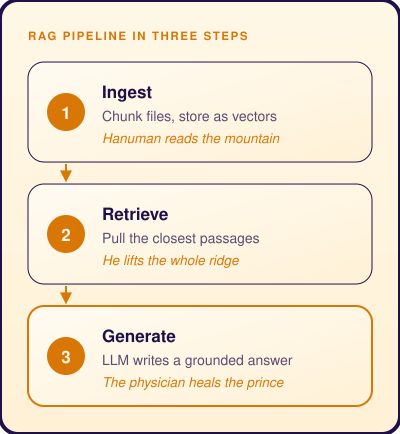
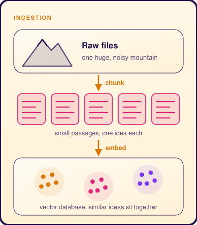
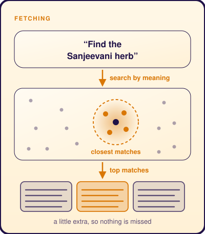
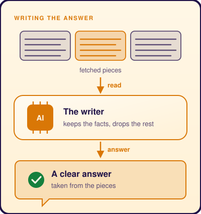

# Understanding RAG Pipelines
Subtitle: Hanuman has until dawn to find one healing herb on a mountain of thousands.
Story: 🏔️ The Mountain Quest · Hanuman
Tags: AI, Technical, RAG
Series: Tarang Tales
Date: 2026-10-02
Summary: Decoding chunking, data retrieval and LLM generation through a legendary rescue mission.

## Race Against Dawn

Artificial Intelligence can now write about almost anything, yet one problem refuses to go away. Left to themselves, large language models guess, and a confident guess is called a **hallucination**. To stop the guessing, engineers build an engine called **RAG**, or Retrieval-Augmented Generation.

To see how a RAG pipeline works, we go back to the **Ramayana** and a race against dawn.

During a great battle, the prince **Lakshmana** lies unconscious on the battlefield. The royal physician, **Sushena**, gives a clear ultimatum. A rare medicinal herb called **Sanjeevani** grows on a distant Himalayan mountain. Bring it before dawn, or the prince will not survive.

There is no time for trial and error and no room for mistakes. This rescue mission maps closely onto the path a RAG pipeline follows when it answers a question from verified facts.

New to the series? Start with [why RAG stops AI from guessing](posts/the-arjuna-algorithm/) and [how vector databases map meaning](posts/ultimate-cosmic-race/).

## Quest at a Glance

1. **Ingestion.** Hanuman reads the mountain patch by patch, the way a pipeline breaks files into chunks and stores them in a vector database.
2. **Retrieval.** He lifts the whole ridge that holds the herb, the way a retriever pulls the closest matching passages with a little context to spare.
3. **Generation.** The physician prepares the exact cure from that material, the way a language model writes an answer from the passages it was given.

## 1. Ingestion and Vector Storage

The warrior **Hanuman** flies to **Mount Dronagiri** and finds a sprawling wilderness covered in thousands of plants, trees and roots. The medicine is there, but it is surrounded by background noise.

Before an AI can answer a question, it faces the same challenge with its raw data.

- **Chunking.** Hanuman can't take in the whole mountain as one massive object. He reads the terrain patch by patch. In the same way, a RAG system slices large documents and files into small, manageable passages called **chunks**.
- **Vector embeddings.** Every plant on the mountain has its own properties, altitude and location. In AI, each chunk is converted into a list of numbers called a **vector embedding** and stored in a **vector database**, where passages with similar meanings sit right next to each other.

## 2. Semantic Retrieval

Standing on the mountain, Hanuman holds on to the physician's instruction. Find the Sanjeevani herb. That instruction is the **user query**.

He doesn't scan the mountain for any green plant. He looks for the specific properties of the medicine, matching the intent and meaning of the request rather than the surface.

When the herb proves hard to isolate in time, Hanuman makes a strategic call so he won't return empty-handed. He lifts the entire ridge that holds the medicinal plants, which makes sure the right herb is inside his payload before dawn.

In an AI system, this is **retrieval**. The retriever turns the question into a vector embedding, searches the vector database for the nearest matches and pulls the top few passages out of the background noise. Like the ridge, that payload deliberately holds a little more than the exact answer, so nothing important is left behind.

## 3. LLM Generation

Hanuman returns and sets the ridge down in front of the medical tent. A raw mass of rock, mud and unrefined plants can't heal the prince on its own. The material is still too raw to use.

This is where the physician steps in. He represents the **Large Language Model**, or LLM, also called the **generator**.

The physician no longer needs to guess at a cure, because the source material is right in front of him. He picks out the exact leaves, prepares the medicine and gives it to the prince, who recovers.

In the final phase of RAG, the LLM reads the retrieved passages, sets aside what is irrelevant and uses its language skills to write a clear, natural answer grounded in that evidence. When you ask a data-backed AI tool a question, this whole journey usually runs in a second or two.

Building a reliable AI isn't about giving a model a bigger brain. It's about building the engine that knows how to bring the mountain to the physician.

> Map the mountain, lift what matters, and let the physician do the healing.
