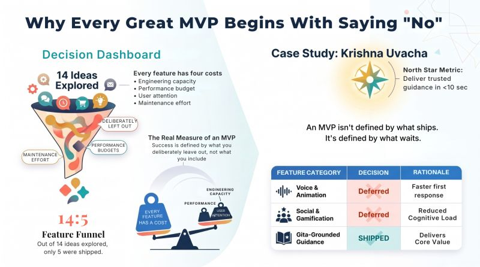

# Why Every Great MVP Begins With Saying "No"
Tags: AI, Project Management, Krishna Uvaca
Series: Surabhi's Slate
Card: linkedin.jpg
Date: 2026-07-23
Summary: Most people judge an MVP by what it includes. I've come to believe the real measure of an MVP is what you deliberately leave out.

*Originally posted on [LinkedIn](https://www.linkedin.com/feed/update/urn:li:activity:7486004822849200128/) on July 23, 2026.*

Most people judge an MVP by what it includes. I've come to believe the real measure of an MVP is what you deliberately leave out.

📊 Decision Snapshot  
14 ideas explored  
5 features shipped  
9 features deliberately deferred

🎯 North Star Metric  
Deliver trusted guidance in &lt;10 seconds

⚖️ Key Trade-off  
Delight vs Simplicity

When I started building my product, I had no shortage of ideas.  
🎙 Voice conversations • 🌌 Animated backgrounds • 🔖 Bookmarks • 📔 Personal journal • 🔔 Daily wisdom • 🤝 Sharing • 🎮 Gamification

Every one of them sounded valuable. None of them solved the first problem.  
Before building, I asked a simple product question: What is the single most valuable outcome a user should experience within the first few seconds?"

The answer wasn't animations. It wasn't personalization.  
It was this: Receive meaningful guidance, grounded in the Bhagavad Gita, as quickly as possible.

That became the product's North Star Metric. Everything else moved to the backlog.

After nearly 20 years of building enterprise platforms, one lesson keeps repeating itself.

Every feature consumes finite organizational resources:  
• Engineering capacity  
• Performance budget  
• User attention  
• Product clarity  
• Delivery Bandwidth

Every roadmap has two costs. The cost of building and the cost of maintaining. The hardest and often the best product decision is knowing what not to build. Saying "No" isn't about reducing ambition. It's about protecting clarity.

Whether you're building a small AI application or an Enterprise platform, the first version shouldn't prove everything. It should prove one thing exceptionally well.

Every successful platform eventually reaches a point where saying 'No' creates more value than saying 'Yes'.

🌿 Try Krishna Uvacha: 🔗 https://krsna.sandeepmidde.com  
I'd love your feedback on the MVP.

As you try it, ask yourself:  
"Is there anything here that feels unnecessary or anything essential that's still missing?"

Fellow builders:  
What's one feature you've deliberately not built because it made the overall product better?

#ProductThinking #MVP #ProductDevelopment #ArtificialIntelligence #BuildInPublic

---

*Join the conversation [on LinkedIn](https://www.linkedin.com/feed/update/urn:li:activity:7486004822849200128/).*
