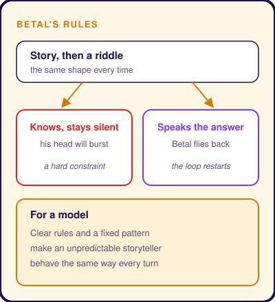
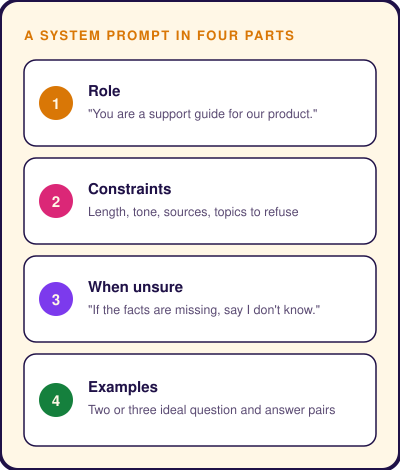

# Prompt Engineering Explained
Subtitle: Twenty-four times King Vikram answers Betal's riddle and loses his prize. The twenty-fifth time, silence sets him free.
Story: 🌙 Vikram and Betal · King Vikram
Tags: AI, Technical
Series: Tarang Tales
Date: 2026-10-28
Summary: How standing rules, clear questions and a safe way to say "I don't know" make a language model reliable.

## Loose Question, Loose Answer

Ask a language model a loose question. You get a loose answer.

Too long when you wanted short. Confident when it should be careful. Chatty when you needed formal.

The model is not broken. It did its best with what you gave it.

**Prompt engineering** is the craft of giving it better instructions. And an old Indian tale teaches it well, including the most common mistake.

## Night in the Cremation Ground

Midnight. A cremation ground, lit by a thin moon.

King **Vikram** has made a promise to a sage. Bring me the corpse that hangs from the old tree.

Vikram climbs the tree, cuts the body down and lifts it onto his shoulder. Then the corpse laughs.

It is possessed by **Betal**, a clever spirit.

"It is a long walk, King," says Betal. "I will tell you stories on the way. But first, two rules."

"Speak."

"One. You will walk in silence. Say a single word, and I fly back to my tree."

"And two?"

"At the end of each story, I will ask a riddle. If you know the answer and keep quiet, your head will burst into a thousand pieces."

Vikram nods and begins to walk.

## First Riddle

Betal tells of a woman whose husband and brother both lose their heads. A goddess lets her join the heads back on. In her hurry, she swaps them.

"So tell me, King. Which man is now her husband?"

Vikram thinks. He knows.

"The one with the husband's head," he says. "The head rules the body."

"Correct!" cries Betal. "And you spoke."

With a shriek, he flies back to the tree.

## Story to System

| In the story | In a prompt |
|---|---|
| Vikram, wise and willing | The language model |
| Two rules set before the walk | The **system prompt**, standing rules for every turn |
| Each tale and its riddle | The **user prompt**, context plus one clear question |
| Vikram answers only from the tale | Grounding, answering from the context given |
| Betal flies back | A failed answer, so you fix the prompt and try again |

## Trap in the Rules

Look closely at Betal's rules.

*Stay silent.* *Answer if you know.*

If Vikram knows the answer, he cannot obey both. And he is wise, so he almost always knows.

He is trapped. Twenty-four times the walk ends at the tree. Not because the king is weak. Because the rules fight each other.

Models fall into the same trap. Imagine a prompt with these two lines.

- *Always give a complete answer.*
- *Never state anything you are not sure of.*

When the model is unsure, it must break one. It usually breaks the second. That is how a confident guess is born.



## Twenty-Fifth Night

Betal tells one last tale. A father and son marry a mother and her daughter. The father marries the daughter. The son marries the mother. Both couples have children.

"How are those children related to each other?"

Vikram thinks. And thinks.

He truly does not know. So he says nothing.

His silence breaks neither rule. The walk is finally complete. Betal, pleased, warns him of the sage's wicked plan.

The fix was never a smarter king. It was a **safe way to not know**.

## See It Work

A bank builds a support assistant. Here is the first prompt.

```text
Help customers with their savings account questions.
```

A customer asks, "Can I withdraw early from my fixed deposit?" The model invents a penalty. Or rambles about deposits in general.

Now the prompt is written like Betal's rules, but rules that can all be kept.

```text
You are the support guide for Acme Bank savings and fixed deposit accounts.
Answer only from the policy passages given with the question.
Keep answers under 80 words, in plain English, and name the policy you used.
If the passages do not answer the question, say "I don't have that detail,
here is how to reach an advisor" and stop.
Example question. What is the minimum balance for a savings account?
Example answer. The minimum balance is 1,000 rupees (Savings Account Policy).
```

Each line does one job.

- **Role.** Who the model is, and who it serves.
- **Grounding.** Answer only from what was given, as Vikram did.
- **Format.** Length, tone and a source, so the answer is usable.
- **A way out.** Permission to say "I don't know". The lesson of the twenty-fifth night.
- **An example.** One sample reply shows the shape. This is called **few-shot prompting**.



## Where the Story Stops

Vikram needed twenty-four failures. You can learn faster.

Test your prompt on a set of real questions. Include ones it should refuse. Each wrong answer is a flight back to the tree. It tells you which rule to fix.

## Takeaway

A model follows your rules as faithfully as Vikram followed Betal's. If the rules clash, it fails faithfully too.

Write rules that can all be kept at once. And always leave a door marked "I don't know".

> Set the rules before the story begins, and make sure they can all be kept.
