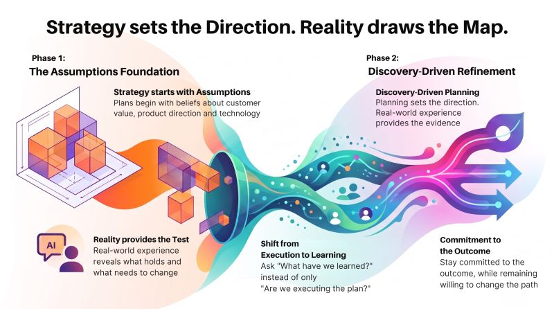

# Strategy Sets the Direction. Reality Draws the Map
Tags: AI, Project Management
Series: Surabhi's Slate
Card: linkedin.jpg
Date: 2026-08-11
Summary: Strategy is a commitment to the outcome, not the original path. Every strategy starts with assumptions. What customers will value?

*Originally posted on [LinkedIn](https://www.linkedin.com/feed/update/urn:li:activity:7492963346233794561/) on August 11, 2026.*

*Strategy is a commitment to the outcome, not the original path*.

Every strategy starts with assumptions. What customers will value? What the product should become? Where technology should be invested? What will create the greatest business value? Those assumptions are necessary. But they are still assumptions.

The real test begins when strategy meets reality. While shaping a conversational product, the initial direction is generally based on assumptions about the experience, the audience and the value it could provide.

Those assumptions could be tested only when the product moved into real use. That is where **discovery-driven planning** becomes important.

Planning provides direction. Real-world experience provides evidence.  
Some assumptions become stronger. Others need refinement. And occasionally, something that looked important during planning matters far less once the product exists.

**That isn't a failure of strategy. That is strategy getting better**.

This changes how progress should be viewed.  
Not simply: “*Are we executing the plan*?”  
But: “*What have we learned that should influence the plan*?”

That question extends well beyond product development.  
It influences technology investment. It influences priorities. It influences when to scale an idea and when to keep learning. Most importantly, it influences how leaders make decisions when certainty is impossible.

**Strategy is not a commitment to the original plan. It is a commitment to the outcome, while remaining willing to change the path when reality provides better information**.

That is why **market fit cannot be designed entirely in a planning room**. It has to be discovered through evidence. The strongest strategies aren't necessarily the ones that survive reality unchanged. They are the ones that become better because reality challenged them.

💬 How often should new evidence be allowed to change a strategy already in motion?

#TechnologyLeadership #TechnologyStrategy #ProductStrategy #DiscoveryDrivenPlanning #MarketFit #Leadership #AI

---

*Join the conversation [on LinkedIn](https://www.linkedin.com/feed/update/urn:li:activity:7492963346233794561/).*
