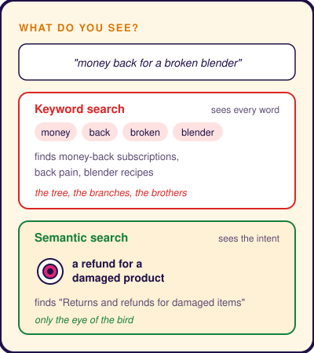
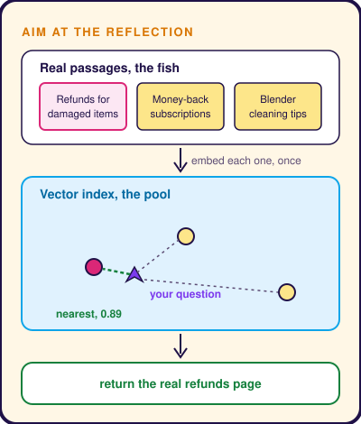

# Mechanics of Semantic Search
Subtitle: Looking only at its reflection in the water, Arjuna pierces the eye of a spinning fish.
Story: 🏹 The Archer's Target · Arjuna
Tags: AI, Technical, RAG
Series: Tarang Tales
Date: 2026-10-01
Summary: How AI search finds what you mean, not just the words you typed, told through two of Arjuna's archery tests.

## Blender Problem

Your new blender breaks on day two. You open the shop's help page and type.

*"Money back for a broken blender."*

Back come a page on money-back subscriptions, an article on back pain, and a blender recipe.

The page you need is called "Returns and refunds for damaged items". It never shows up. It does not share a single word with what you typed.

The search box read your words. It never understood what you meant.

How do engineers build search that understands? Two archery tests from the **Mahabharata** show the way.

## What Do You See?

Morning in the forest school. A wooden bird sits high in a tree.

The teacher **Drona** calls his students, one by one.

"Raise your bow," he says. "Now tell me. What do you see?"

**Yudhishthira** squints upward. "I see the tree. The branches. The bird. My brothers. And you, Guru."

"Lower your bow," says Drona.

The others answer the same way. Tree, leaves, sky, bird.

Then **Arjuna** steps up.

"What do you see?"

"The eye of the bird."

"Nothing else?"

"Only the eye."

"Shoot."

The arrow flies. It strikes the eye.

## Spinning Fish

Years later. A royal hall, crowded with kings.

High on a pole, a wooden fish spins on a wheel. Below it lies a still pool of water.

"Pierce the fish's eye," the herald announces. "But you may not look up. Look only at its reflection in the pool."

Prince after prince kneels by the water. The reflection wobbles. They shoot. They miss. The crowd groans.

Arjuna kneels. He waits for the ripples to settle. The reflection grows sharp and clear.

He draws, aims at the image below, and sends the arrow upward.

It hits the eye of the real fish. The hall erupts.

## What Arjuna Knew

**Yudhishthira saw everything** in front of him, and every part counted the same. That is how the old help page searched. It saw *money*, *back*, *broken* and *blender*, and fetched anything containing them. Engineers call this **keyword search**.

**Arjuna saw only the eye.** He looked past everything else to the one thing that mattered. Good search does the same. It looks past your words to what you mean, a refund for a damaged product. This is **semantic search**, search by meaning.

**Arjuna aimed at the reflection,** not the fish. Semantic search works this way too. It never compares your words with every page directly. Each page is first turned into a kind of reflection, a list of numbers that captures what it means. Engineers call this an **embedding**.

**The reflection pointed to the real fish.** When search finds the closest reflection, it hands you the real page behind it.

Just as Arjuna saw only the eye, the search finally sees your refund.

## Searching by Reflection

So engineers build search the way Arjuna aimed.

Long before anyone asks anything, every page gets its reflection. All the reflections are kept together, like images in one still pool.

When you type a question, it gets a reflection too.

The search looks for the reflections sitting closest to yours. Pages that mean similar things sit close together, even when their words are different. "Refund", "money back" and "return my order" all land near each other, just as the spinning fish always cast the same reflection.

Still water matters. Messy, overlong pages blur the reflection, the way ripples did. Clean, short pages give a sharp one.

## Story to System

| In the story | In semantic search |
|---|---|
| "What do you see?" | Working out what a question means |
| Tree, branches, bird, brothers | Keyword search, every word counts |
| Only the eye | Search by meaning |
| The fish's reflection | A page turned into numbers, its embedding |
| Aim at the image, hit the fish | Find the closest reflection, return its page |
| Ripples on the water | Messy pages, blurry results |

## See It Work

The shopper types, *"Money back for a broken blender."*

1. **Reflect.** The question is turned into its list of numbers.
2. **Compare.** The search checks how close it sits to each help page's reflection.
3. **Rank.** "Returns and refunds for damaged items" sits closest, though it shares no words. The money-back page comes second. The blender recipe comes last.
4. **Answer.** The refund page goes to the top.

The arrow hits the eye, not the tree.

## Where the Story Stops

Arjuna shot one arrow. Search usually returns a few close pages, best first.

And meaning is not everything. A product code like *BL-4021* has no meaning to reflect. So many systems search by meaning and by exact words together.

What happens to those pages next is the story of [RAG](posts/mountain-quest/). How millions of reflections are searched in a blink is the story of [vector databases](posts/ultimate-cosmic-race/).

## Takeaway

The old help page read your words. It needed to understand you.

Search by what people mean, not by the words they happen to type.

> Look past the words. Aim at the meaning.
