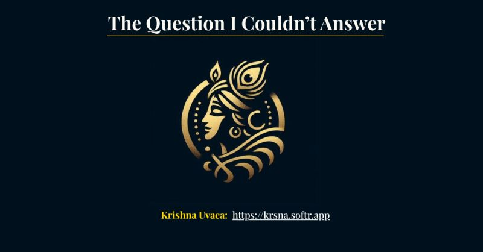

# The Question I Couldn't Answer
Tags: AI, Krishna Uvaca
Series: Surabhi's Slate
Card: linkedin.jpg
Date: 2026-07-20
Summary: Some questions stay with you long after they've been asked. This was one of them. One evening, my child asked me something about a friendship.

*Originally posted on [LinkedIn](https://www.linkedin.com/feed/update/urn:li:activity:7485045944292495360/) on July 20, 2026.*

Some questions stay with you long after they've been asked. This was one of them.

One evening, my child asked me something about a friendship. To me, it felt like one of those worries that time quietly heals. To my child, it was the whole world.

Almost instinctively, I said,  
"You know.. Krishna once spoke about something like this to Arjuna..."

And then I stopped.

Because I couldn't remember what Krishna had actually said.

That moment stayed with me.

After nearly two decades of building technology to solve complex business problems, I realised I didn't have a system for the one body of knowledge I wanted to understand most deeply.

So I built one.

Over the past few weeks, I've been building Krishna Uvaca - an MVP that explores how modern technology can help us apply the timeless wisdom of the Bhagavad Gita for modern-day questions.

What surprised me wasn't building the product. It was the decisions hiding behind it.  
\> Should every question receive an answer?  
\> When is silence better than confidence?  
\> How much context is enough?  
\> How do you preserve authenticity without sounding mechanical?  
\> How do you balance trust, latency, accuracy, cost and user experience?

Somewhere along the way, I realised I wasn't just building an application. I was designing trust.

And that reminded me of something I'll carry into every product I build: "Building software is often the easier part. Building something people genuinely trust is much harder."

Today, that unanswered question has taken shape as Kṛṣṇā Uvāca - Inspired by ancient wisdom, Built for modern questions.

If you have a few minutes, I'd genuinely love your feedback.  
👉 https://krsna.sandeepmidde.com

This is Part 1 of a series documenting the journey behind Krishna Uvaca - from idea to MVP, and the product thinking, architecture, trade-offs, and lessons that shaped it

Have you ever had a moment where a simple question exposed a gap you didn't know you had?

#ProductDevelopment #ProductThinking #ArtificialIntelligence #BhagavadGita #BuildInPublic

---

*Join the conversation [on LinkedIn](https://www.linkedin.com/feed/update/urn:li:activity:7485045944292495360/).*
