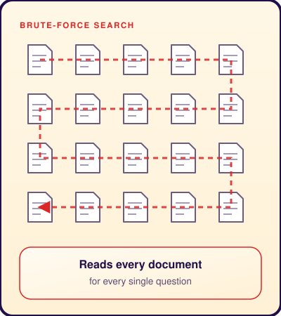
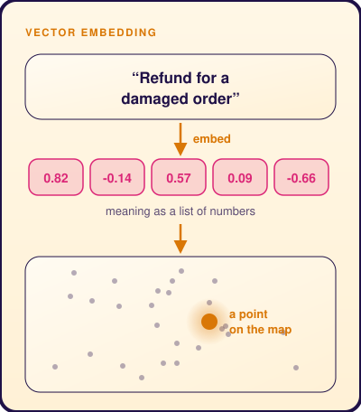
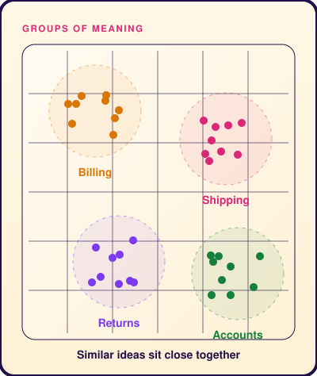
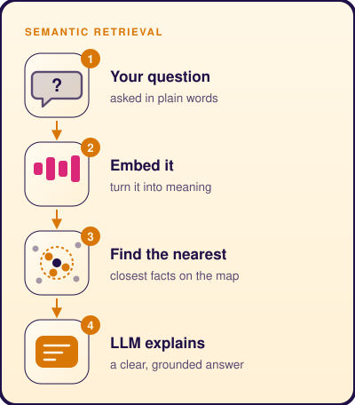

# Demystifying Vector Databases
Subtitle: Kartikeya races across the cosmos. Ganesha circles his parents and wins.
Story: 🪐 The Cosmic Race · Ganesha
Tags: AI, Technical, RAG
Series: Tarang Tales
Date: 2026-10-02
Summary: How AI systems find the right passage among millions in a blink, told through a race around the universe.

## Needle in a Galaxy

In the [last story](posts/the-arjuna-algorithm/), every passage got a **reflection**, an embedding that captures its meaning. Search meant finding the reflection closest to your question.

Easy with three passages. But what about three million?

Comparing your question with every one, every time, would be far too slow. A **vector database** solves this. To see how, we go to Mount Kailash.

## Golden Fruit

One day the sage **Narada** arrives at Kailash with a single golden fruit. It holds the essence of all wisdom.

**Shiva** and **Parvati** have two sons. Both want the fruit.

"There is only one," says Shiva. "So, a race. Whoever goes around the whole universe three times and returns first, wins it."

**Kartikeya** does not wait. He leaps onto his peacock and shoots into the sky.

**Ganesha** looks at his mount. A small mouse.

He sits down. He thinks.

## Kartikeya's Way

Kartikeya flies past every star. Every planet. Every corner of the cosmos. He misses nothing.

He is thorough. He is also very, very slow.

This is **brute-force search**. Your question is compared with every single passage, one by one. With a few hundred passages, that is fine. With millions, it takes too long. And it starts again from zero for every new question.

## Ganesha's Way

Ganesha stands up. He walks to his parents.

"Please, sit together," he says.

Then he walks around them. Once. Twice. Three times. He bows.

"I am back," he says. "I have won."

Parvati smiles. "You never left Kailash."

"To me, you two are the whole universe," says Ganesha. "Everything in it is held in you. Circling you is circling all of it."

Shiva laughs and hands him the fruit.

## What Ganesha Knew

Ganesha did not visit every star. He found what **stood for** all of them. Vector databases use the same idea, in two steps.

1. **Turn meaning into numbers.** Each passage becomes an **embedding**, a short list of numbers. Passages that mean similar things get similar numbers. So they sit close together, like stars in one constellation.

2. **Pick a representative for each neighbourhood.** The database groups nearby passages into neighbourhoods. Each one gets a representative point, its centre. Like Shiva and Parvati, that one point stands for everything around it.

Now a question arrives. The database does not visit every passage.

- It first circles the representatives. Which neighbourhoods are closest to the question?
- Then it searches **only inside those few**.

## Story to System

| In the story | In a vector database |
|---|---|
| The whole universe | Millions of stored passages |
| Kartikeya visiting every star | Brute-force search, compare with everything |
| Parents who stand for the universe | Representatives for each neighbourhood |
| Circling his parents | Comparing the question with representatives first |
| Winning without leaving home | Fast answers without scanning everything |

## See It Work

A company stores 1,000,000 passages from its manuals.

**Kartikeya's way.** One question means 1,000,000 comparisons.

**Ganesha's way.** The database has grouped the passages into 1,000 neighbourhoods.

1. Compare the question with the 1,000 representatives.
2. Pick the 5 closest neighbourhoods. About 5,000 passages live there.
3. Compare the question with those 5,000.

That is about 6,000 comparisons instead of a million. Less than one percent of the work.

## Where the Story Stops

Ganesha's answer was perfect. A vector database's answer is *almost* perfect.

Now and then, the very best passage sits in a neighbourhood the search skipped. That is why these methods are called **approximate nearest neighbour** search. Teams tune how many neighbourhoods to check. More gives better accuracy. Fewer gives more speed.

Real databases such as FAISS, Pinecone and pgvector use this idea and others like it.

## Takeaway

Speed does not come from flying faster. It comes from knowing what stands for everything else.

> Don't race around the universe. Circle what holds it.
